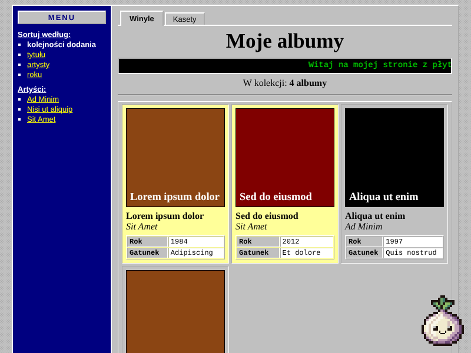
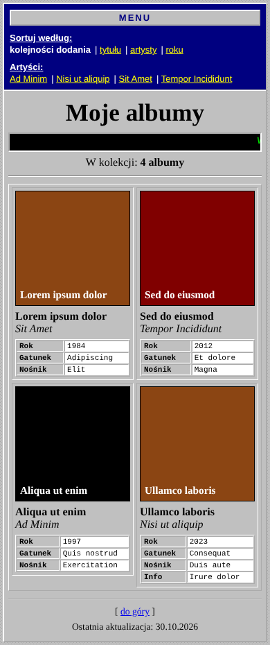

# Moje albumy

Aplikacja do katalogowania płyt.





## Funkcje

- Albumy wyświetlane w kwadratach: okładka, tytuł, artysta, tabelka z informacjami i notatka
- Album bez okładki dostaje kolor z tytułem
- Sortowanie według kolejności dodania, tytułu, artysty lub roku
- Spis artystów w menu, który podświetla na żółto wszystkie albumy danego artysty

## Pliki

| Plik | Do czego służy |
|------|----------------|
| `index.html` | Dział Winyle: szkielet strony i tekst przewijanego napisu |
| `kasety.html` | Dział Kasety: ten sam szkielet |
| `style.css` | Wygląd |
| `app.js` | Zakładki działów, wyświetlanie albumów, sortowanie i podświetlanie |
| `winyle.js` | **Lista winyli** |
| `kasety.js` | **Lista kaset** |
| `covers/` | Okładki winyli (opcjonalnie, nie trafiają do repozytorium) |
| `covers/kasety/` | Okładki kaset (opcjonalnie, nie trafiają do repozytorium) |

## Dodawanie albumu

W `winyle.js` (tablica `WINYLE`) albo `kasety.js` (tablica `KASETY`) dopisz kolejny wpis:

```js
{
  title: "Tytuł albumu",
  artist: "Wykonawca",
  cover: "covers/okladka.jpg",
  info: { Rok: "1997", Gatunek: "Rock", Nośnik: "CD" },
  note: "Krótka notatka."
}
```

## Uruchomienie

Wystarczy skopiować cały folder do katalogu, z którego serwer WWW podaje pliki (np. `/var/www/html/albumy`).

## Licencja

Kod jest udostępniony na licencji MIT, szczegóły w pliku [LICENSE](LICENSE).
Licencja nie obejmuje okładek albumów: prawa do nich należą do ich właścicieli.
