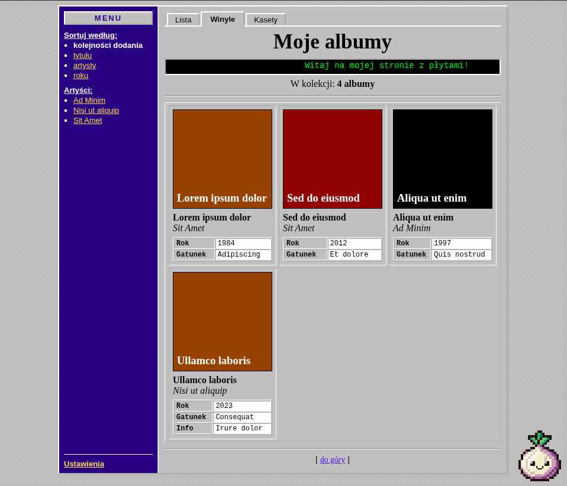

# Moje albumy

Aplikacja do katalogowania płyt.



## Funkcje

- Lista wszystkich albumów
- Przeglądanie kolekcji w działach po nośniku
- Karta albumu z okładką, tytułem, wykonawcą i dowolnymi informacjami
- Sortowanie po tytule, wykonawcy, roku lub kolejności dodania
- Wyróżnienie wszystkich albumów wybranego wykonawcy jednym kliknięciem
- Dodawanie albumów przez edycję pliku
- Włączanie i wyłączanie działów w ustawieniach
- Dwa wyglądy do wyboru w ustawieniach: klasyczny i nowy w stylu okna Windows 98

## Pliki

| Plik | Do czego służy |
|------|----------------|
| `index.html` | Cała aplikacja w wyglądzie klasycznym: lista, działy i ustawienia na jednej stronie |
| `nowy/index.html` | Ta sama aplikacja w nowym wyglądzie |
| `data/winyle.js` | **Lista winyli** |
| `data/kasety.js` | **Lista kaset** |
| `data/cd.js` | **Lista płyt CD** |
| `LICENSE` | Licencja MIT |

## Dodawanie albumu

W `data/winyle.js` (tablica `WINYLE`), `data/kasety.js` (tablica `KASETY`) albo `data/cd.js` (tablica `CD`) dopisz kolejny wpis:

```js
{
  title: "Tytuł albumu",
  artist: "Wykonawca",
  cover: "covers/okladka.jpg",
  info: { Rok: "1997", Gatunek: "Rock" },
  note: "Krótka notatka."
}
```

Okładki wrzuć do folderu `covers/` w głównym folderze projektu (kasety: `covers/kasety/`, płyty CD: `covers/cd/`).
Ścieżkę w `cover` podaj od głównego folderu, tak jak w przykładzie.

## Uruchomienie

Wystarczy skopiować cały folder do katalogu, z którego serwer WWW podaje pliki (np. `/var/www/html/albumy`).

## Licencja

Kod jest udostępniony na licencji MIT, szczegóły w pliku [LICENSE](LICENSE).
Licencja nie obejmuje okładek albumów: prawa do nich należą do ich właścicieli.
